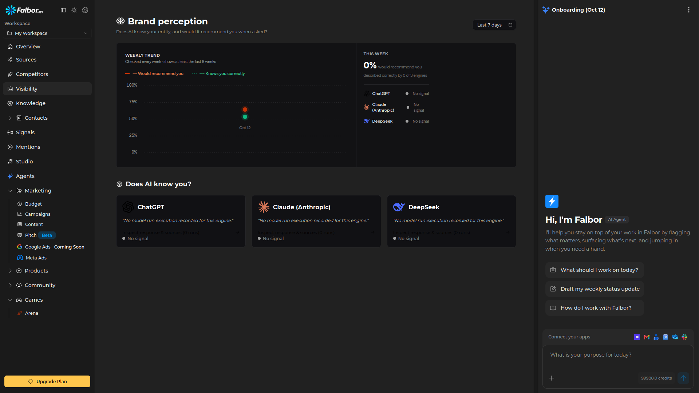

<div align="center">




</div>

<section align="center">
  Falbor is an Open Source AI Marketing Platform for developers, founders, and growth teams. Analyze competitors, track market trends, and automate your growth with full transparency and control.
</section>

<br /><br />

## Links

- [Website](https://falbor.xyz)
- [Cloud Plans](https://falbor.xyz/upgrade)
- [Contact](mailto:contact@falbor.xyz)

## Tech Stack

- **Framework:** Next.js, React, TypeScript, Tailwind CSS
- **Database & ORM:** PostgreSQL (Neon), Supabase, Drizzle ORM
- **AI Integration:** OpenAI, Anthropic, DeepSeek AI Agents

---

## Local Development

### 1. Clone & Install

Navigate to the Falbor app directory and install dependencies:

```bash
git clone [https://github.com/falbor-devs/falbor.git](https://github.com/falbor-devs/falbor.git)
cd falbor/apps/falbor
npm install
```

### 2. Database Setup

The project uses Neon for database management. Create a `.env` file in the `apps/falbor` directory with the following variables:

```bash
DATABASE_URL="postgresql://postgres.xxxx:[EMAIL_ADDRESS]:5432/postgres"
```

Run the following commands to create the necessary database tables:

```bash
npx drizzle-kit generate
npx drizzle-kit push
```

### 3. Environment Variables

Create a `.env` file in `apps/falbor` and add all required environment variables. Here are some examples:

```bash
# Next.js & App Settings
NEXT_PUBLIC_APP_URL="http://localhost:3000"
NEXT_PUBLIC_BASE_DOMAIN="falbor.xyz"

# OpenAI & AI Agents
OPENAI_API_KEY="sk-..."
ANTHROPIC_API_KEY="sk-ant-api03-..."
DEEPSEEK_API_KEY="sk-..."
OPENAI_MODEL="gpt-4o-mini"
```

**Required Environment Variables Checklist:**

- [ ] `NEXT_PUBLIC_APP_URL`
- [ ] `NEXT_PUBLIC_BASE_DOMAIN`
- [ ] `DATABASE_URL`
- [ ] `RESEND_API_KEY`
- [ ] `OPENAI_API_KEY`
- [ ] `ANTHROPIC_API_KEY`
- [ ] `DEEPSEEK_API_KEY`
- [ ] `OPENAI_MODEL`
- [ ] `SERPER_API_KEY`
- [ ] `SERPER_DOMAIN`

### 4. Run the Development Server

Start the development server with:

```bash
npm run dev
```

Open [http://localhost:3000](http://localhost:3000) in your browser to view the live web.

---

## 🔧 AI Integration Notes

The project utilizes three AI providers:

1.  **OpenAI:** For general AI agent capabilities.
2.  **Anthropic:** For the autonomous AI agents that perform market research and competitor analysis.
3.  **DeepSeek:** Also used for AI agents, potentially for alternative analysis paths.

Make sure all API keys are correctly configured in `.env` to ensure the AI features work as expected.

## 🤝 Contributing

We welcome contributions from the community! If you'd like to contribute, please:

1.  Fork the repository.
2.  Create a feature branch (`git checkout -b feature/AmazingFeature`).
3.  Commit your changes (`git commit -m 'Add some AmazingFeature'`).
4.  Push to the branch (`git push origin feature/AmazingFeature`).
5.  Open a Pull Request.

## 📄 License

This project is licensed under the [MIT License](LICENSE).
